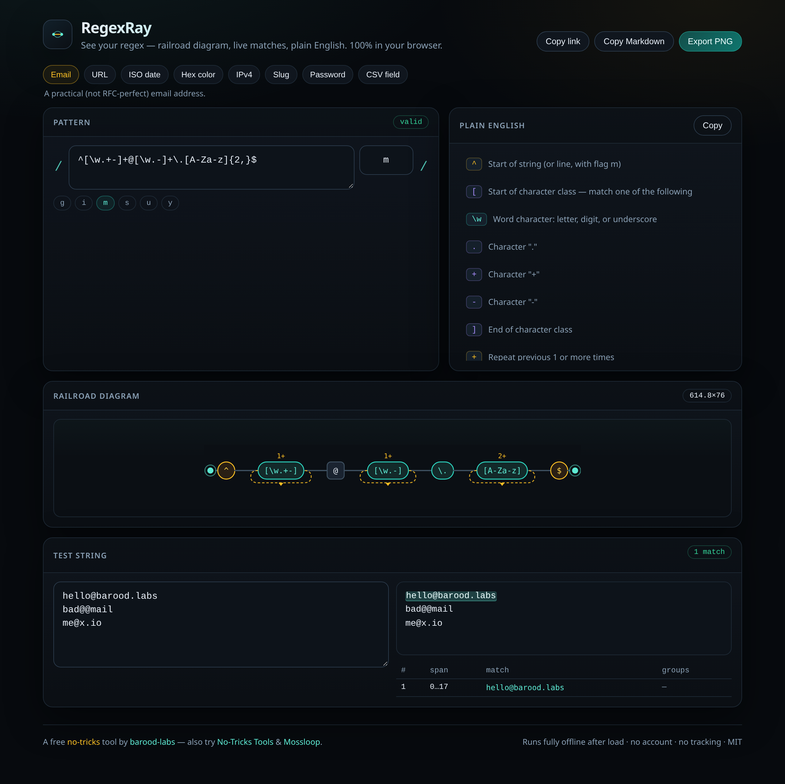

# RegexRay

**See your regex.** Live railroad diagram · match highlighting · plain-English explanations — 100% in your browser.

[](https://barood-labs.github.io/regexray/)
[](./LICENSE)
[](https://barood-labs.github.io/regexray/)

**➜ Live demo:** https://barood-labs.github.io/regexray/



## Why we made it

Every developer has rage-quit a regex. The tools we reach for are either a wall of text, a server-side debugger full of ads, or a static railroad diagram from 2012.

RegexRay is the one page we wanted: paste a pattern, **see** it, match against a test string, and read every token in plain English — with a shareable link and a PNG you can drop into a PR. No account. No tracking. No API key. Works offline after the first visit.

## Features

- **Railroad diagram** — animated SVG of your pattern (groups, lookarounds, quantifiers, classes)
- **Live matches** — highlight hits and capture groups as you type (runs in a Web Worker; runaway backtracking is timed out)
- **Plain English** — every token explained, color-coded
- **Example gallery** — email, URL, ISO date, hex color, IPv4, slug, password, CSV
- **Permalink** — the pattern, flags, and test string live in the URL hash (no backend)
- **Export** — diagram as PNG, or copy as Markdown for READMEs
- **Dark, screenshot-ready UI** — mobile-friendly

## Quick start

```bash
npm install
npm run dev        # http://localhost:5173
npm run build      # static site → dist/
npm run preview
npm run qa         # headless Chromium suite (needs a built dist/)
```

## Deploy

This repo ships with a GitHub Pages Action (`.github/workflows/pages.yml`) that builds `dist/` on every push to `main`. The live site is:

**https://barood-labs.github.io/regexray/**

## Privacy

- No accounts, cookies, analytics, or telemetry
- Matching and diagram rendering happen entirely in your browser
- A shared link only encodes what you put in the hash — nothing is stored on a server

## License

[MIT](./LICENSE) © [barood-labs](https://github.com/barood-labs)

A free **no-tricks** tool. Also try [No-Tricks Tools](https://barood-labs.github.io/notricks-tools/) and [Mossloop](https://barood-labs.github.io/mossloop/).
